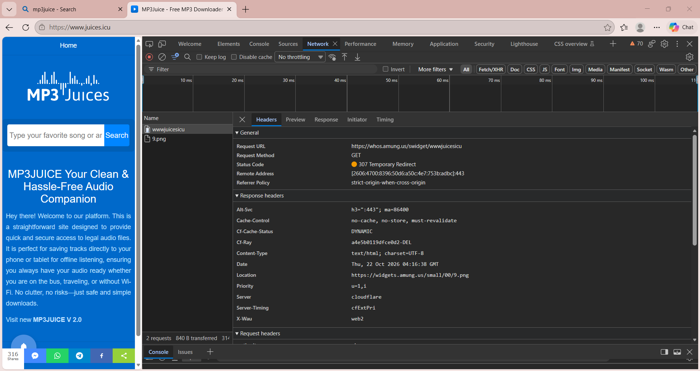

# Assignment 1.1 — How a Website Works

## Objective

To understand how a website loads in a web browser and learn about the browser, client, server, database, HTTP, HTTPS, and the request-response cycle.

## 1\. How Does a Website Work?

When we type a URL (Uniform Resource Locator) into a web browser such as Google Chrome, the browser acts as a client and uses DNS (Domain Name System) to find the IP address of the website's server. The browser then sends an HTTP (Hypertext Transfer Protocol) or HTTPS (Hypertext Transfer Protocol Secure) request to the server. HTTPS provides secure communication by encrypting data exchanged between the client and server. The server receives and processes the request and may communicate with a database to retrieve or store information. It then sends an HTTP response containing resources such as HTML, CSS, JavaScript, and images to the browser. This process is known as the request-response cycle. The browser interprets these resources and displays the website on the screen. A static website generally displays fixed content that remains the same for visitors, whereas a dynamic website can display different content based on user input, database information, or other conditions. We can use Chrome DevTools and its Network tab to inspect website requests, responses, status codes, and loading times.

## 2\. Basic Components of a Website

- **Browser:** A software application, such as Google Chrome, used to access and display websites.
- **Client:** The device or application that sends requests to a server. A web browser acts as a client.
- **Server:** A computer or software system that receives requests, processes them, and returns responses.
- **Database:** A system used to store, organize, retrieve, and manage website data, such as user details and product information.

## 3\. Meaning of HTTP and HTTPS

- **HTTP (Hypertext Transfer Protocol):** A protocol used for communication between a web browser and a web server. It transfers requests and responses over the web.
- **HTTPS (Hypertext Transfer Protocol Secure):** The secure version of HTTP. It uses encryption through TLS to protect data exchanged between the browser and server.

## 4\. Request-Response Cycle

The request-response cycle describes how a browser communicates with a web server.

1. The user enters a URL into the browser.
2. The browser uses DNS to find the server's IP address.
3. The browser establishes a connection with the server.
4. The browser sends an HTTP or HTTPS request.
5. The server processes the request and may retrieve data from a database.
6. The server sends an HTTP response containing the requested content and a status code.
7. The browser processes the response and displays the website.

## 5\. Difference Between Static and Dynamic Websites

| Static Website | Dynamic Website |
| --- | --- |
| Displays fixed content. | Content can change based on user input or other conditions. |
| Usually uses HTML, CSS, and JavaScript files served as they are. | May use server-side code and databases to generate content. |
| Often simpler and faster to host. | May require more processing and infrastructure. |
| Example: A basic personal portfolio page. | Example: An online shopping website with personalized products. |

## 6\. Practical Activity: Inspecting Requests in Chrome DevTools
### Observations

- The Network tab displays the resources requested by the browser.
- The Name column shows the resource or request name.
- The Status column shows the HTTP status code, such as **200**, which indicates a successful request.
- The Type column identifies the resource type, such as document, stylesheet, or script.
- The Size column shows the amount of data transferred or resource size.
- The Time column shows how long the request took.
- The Waterfall section visualizes the timing and order of requests.

### Screenshot

## 7\. Conclusion

In this assignment, I learned how a website loads in a browser and understood the roles of the client, server, browser, and database. I learned the meanings of HTTP and HTTPS, understood the request-response cycle, and identified the differences between static and dynamic websites. I also learned how to use Chrome DevTools to inspect network requests and analyze website loading information.

